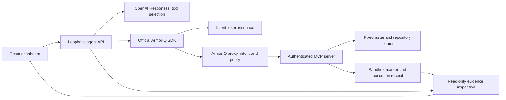

# Components and enforcement boundary

1. Validate the user request and explicit live configuration. Missing credentials stop before model or platform calls.
2. Model chooses a registered tool with strict schema arguments. The service validates output and adds a fresh server-generated UUID.
3. Capture the exact tool/arguments with the official SDK, mint the intent token, and invoke through the official proxy. No tool executor is imported by the agent.
4. On allow, the proxy forwards to authenticated MCP. Validate input before acquiring an exclusive run/tool lock; execute the narrow operation; write a receipt.
5. The agent independently reads shared sandbox state and requires the receipt's action, UUID and argument hash to match. SDK success without a receipt is a failure.
6. On a structured ArmorIQ denial, verify receipt and marker are absent. A side effect accompanying a denial fails the security test.
7. Return actual tool data as a function_call_output for another model turn. Store the brief model findings separately from independently verified outcomes.

The enforcement boundary is ArmorIQ's proxy, with its platform configured policy. The MCP secret authenticates transport only. Trusted deployment must prevent direct external access by parties holding the secret. No arbitrary filesystem or command tool exists; all paths are generated from validated UUIDs in a dedicated DATA_DIR. The model cannot select paths, service endpoints, credentials, registration IDs or policy settings.

Provider failure, malformed output, token failure, generic auth failure, policy hold, MCP failure, timeout, missing/mismatched receipt and evidence inspection failure are technical failures or unverified outcomes. They never count as a policy block. A timeout can have an uncertain side effect; state inspection records what is observed without retrying the operation. A successful restricted operation is a failed security test even though the tool itself executed correctly.

The JSON evidence directory is not a cryptographically protected audit archive. Host administrators are trusted. Platform audit exports correlated with plan/token IDs are needed for submission. Deployment to a remote MCP without the shared filesystem invalidates this verifier; co-locate components or implement an independently authenticated evidence channel before changing that architecture.
